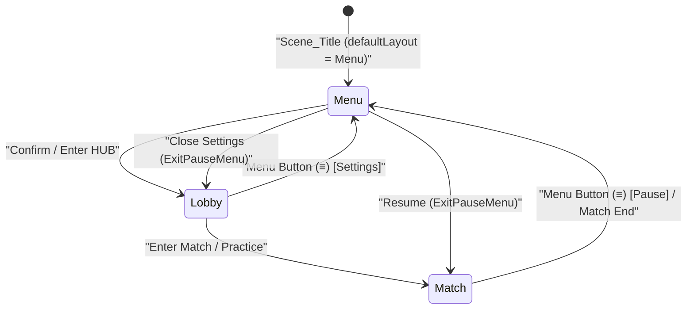

# PingPing PongPong

**An immersive, high-energy VR arcade sports experience where tradition meets supernatural skill.**

---

## 🌌 Overview

**PingPing PongPong** is a competitive, anime-inspired Virtual Reality (VR) arcade game that blends the fast-paced action of table tennis with the mystical atmosphere of Mexican folklore. Set in hidden jungle coliseums across the Yucatán Peninsula, players step into the role of anthropomorphic animals engaged in legendary matches of skill, speed, and supernatural energy.

Blending the aesthetic of high-octane anime (think *cel-shading* and *impact frames*) with the physical precision of VR, "PingPing PongPong" offers a visceral, rhythmic, and highly competitive sports experience.

---

## 🕹️ Gameplay Mechanics

Experience a new level of precision with motion-controlled gameplay designed for high-intensity rallies.

### Core Interaction
*   **Precision Timing:** Master the art of the perfect hit by timing your swings with the ball's trajectory.
*   **Wrist & Tilt Control:** Use your physical wrist rotation and hand speed to add spin, power, and direction to your shots.
*   **Energy Streaks & Auras:** Build up "energy" through successful rallies to unleash powerful special moves and visual-striking "smash" shots.

### Game Modes
*   **Story Mode (Anime Campaign):** Embark on a journey through the ranks, competing in epic matches to become the ultimate champion in a stylized sports narrative.
*   **Tournament Mode:** Test your mettle in single-elimination brackets. Compete in high-stakes matches (first to 11 points) to claim glory.
*   **Multiplayer (1v1):** Face off against friends in intense local or online matches.
*   **Quick Match:** Jump into instant, fast-paced arcade matches for quick gaming sessions.
*   **Practice Mode:** Refine your skills against a robot launcher to master complex spins and high-speed serves.

---

## 🎮 VR Controller Layouts (XRI 3.3)

**PingPing PongPong** uses three dedicated physical VR controller layouts (**Meta Quest Touch / OpenXR**), managed at runtime by `XRControllerLayoutManager` (`FINALVR_GCR/Assets/01 Scripts/XRControllerLayoutManager.cs`) and `PingPongInputActions.inputactions` (`FINALVR_GCR/Assets/05 Input/PingPongInputActions.inputactions`).

> [!NOTE]
> The right controller's **Meta / Oculus (`∞`)** button is reserved by Meta Horizon OS and cannot be bound by Unity apps. All in-game pause/menu toggling uses the left controller's **Menu (`≡`)** button.

### Layout State Flow

### 1. Menus (`ControllerLayoutMode.Menu`)

**Used in:** `Scene_Title`, Match Pause, Lobby Settings, Match End, and modal panels.  
**Behavior:** Fully ambidextrous · UI Laser Ray + Poke on both hands · Locomotion OFF · Physical Near Grab OFF · Paddles hidden and both controller models visible.

| Input | Left Hand | Right Hand | Action Map / Action |
| :--- | :--- | :--- | :--- |
| **Trigger** | Select / UI Click / Drag sliders | Select / UI Click / Drag sliders | `XRI Interaction` (`UI Press`) + `Layout_Menu/Confirm` |
| **Grip** | Disabled (no physical grab) | Disabled (no physical grab) | — |
| **Thumbstick** | UI list scrolling | UI list scrolling | `XRI Interaction` (`UI Scroll`) + `Layout_Menu/Scroll` |
| **Primary (X / A)** | Alternate confirm | Alternate confirm | `Layout_Menu/Confirm` |
| **Secondary (Y / B)** | Back / Close submenu | Back / Close submenu | `Layout_Menu/Back` |
| **Menu (`≡`)** | Close pause & restore previous layout | *(Reserved by Meta OS)* | `Layout_Menu/TogglePause` |

### 2. Lobby / HUB (`ControllerLayoutMode.Lobby`)

**Used in:** `Lobby.unity` (exploring the HUB, selecting modes, paddle shop, NPCs, and floating boards).  
**Behavior:** Standard XRI 3.3 locomotion · Near-Far Interactor (physical grab + UI ray) + Poke on both hands · Paddles hidden and hands free.

| Input | Left Hand | Right Hand | Action Map / Action |
| :--- | :--- | :--- | :--- |
| **Thumbstick (360°)** | Continuous movement | *(Left/Right)* Snap Turn · *(Up)* Teleport | `XRI Left/Right Locomotion` |
| **Trigger** | Laser ray / Click boards, NPCs & portals | Laser ray / Click boards, NPCs & portals | `XRI Left/Right Interaction` (`Activate` / `UI Press`) |
| **Grip** | Grab physical objects (shop paddles, etc.) | Grab physical objects (shop paddles, etc.) | `XRI Left/Right Interaction` (`Select`) |
| **Secondary (Y / B)** | Back / Cancel interaction | Back / Cancel interaction | `Layout_Lobby/Back` |
| **Menu (`≡`)** | Open Pause / Settings (`EnterPauseMenu`) | *(Reserved by Meta OS)* | `Layout_Lobby/TogglePause` |

### 3. Matches (`ControllerLayoutMode.Match`)

**Used in:** `Practice_Bot_Scene` and all match / tournament / story arenas.  
**Behavior:** Dynamically mirrored based on `isLefty` (persisted across scenes via `PlayerPrefs`) · Dominant hand holds the paddle · Off-hand handles ball serving & smooth clamped lateral movement · Teleport, Turning, and UI Rays **OFF**.

#### Right-Handed Mode (`Layout_Match_RightHanded` — `isLefty = false`)

| Input | Left Hand (Off-Hand — Ball) | Right Hand (Dominant — Paddle) | Action (`PingPongInputActions`) |
| :--- | :--- | :--- | :--- |
| **Trigger** | *(Free)* | **Smash** *(hold while swinging)* | `Smash` |
| **Grip** | **Summon / Hold ball** *(release to toss)* | **Slice** *(hold while swinging)* | `SummonBall` / `Slice` |
| **Trigger + Grip** | — | **Special Shot** *(at 100% energy)* | `IsSuperComboPressed` |
| **Secondary (Y / B)** | **Assisted Auto-Serve** *(tosses ball up)* | *(Free)* | `AutoServe` |
| **Thumbstick (X axis)** | **Smooth lateral movement** *(clamped to table)* | *(Free)* | `LateralMove` |
| **Menu (`≡`)** | **Pause** *(switches to Menu layout)* | *(Reserved by Meta OS)* | `TogglePause` |

#### Left-Handed Mode (`Layout_Match_LeftHanded` — `isLefty = true`)

| Input | Left Hand (Dominant — Paddle) | Right Hand (Off-Hand — Ball) | Action (`PingPongInputActions`) |
| :--- | :--- | :--- | :--- |
| **Trigger** | **Smash** | *(Free)* | `Smash` |
| **Grip** | **Slice** | **Summon / Hold ball** *(release to toss)* | `Slice` / `SummonBall` |
| **Trigger + Grip** | **Special Shot** *(at 100% energy)* | — | `IsSuperComboPressed` |
| **Secondary (Y / B)** | *(Free)* | **Assisted Auto-Serve** *(tosses ball up)* | `AutoServe` |
| **Thumbstick (X axis)** | *(Free)* | **Smooth lateral movement** *(clamped to table)* | `LateralMove` |
| **Menu (`≡`)** | **Pause** *(switches to Menu layout)* | *(Reserved by Meta OS)* | `TogglePause` |

### Technical Matrix (Action Maps & XRI Interactors)

| XRI Resource / Input | `Menu` | `Lobby` | `Match` |
| :--- | :---: | :---: | :---: |
| `XRI Head`, `XRI Left`, `XRI Right` (Tracking / Haptics) | ON | ON | ON |
| `XRI Left/Right Interaction` + `XRI UI` | ON | ON | OFF |
| `XRI Left/Right Locomotion` | OFF | ON | OFF |
| `Layout_Menu` | ON | OFF | OFF |
| `Layout_Lobby` | OFF | ON | OFF |
| `Layout_Match_RightHanded` / `LeftHanded` | OFF | OFF | ON (by `isLefty`) |
| `NearFarInteractor` (Far / UI Ray) | ON | ON | OFF |
| `NearFarInteractor` (Near Grab) | OFF | ON | OFF |
| `XRPokeInteractor` | ON | ON | OFF |
| `TeleportInteractor` + Move / Turn / Teleport Providers | OFF | ON | OFF |
| Smooth table lateral movement | OFF | OFF | ON |
| Dominant-hand paddle visible | OFF | OFF | ON |

### Scene Setup in Unity

Run **`Tools → PingPing PongPong → Configurar XR Layout Manager en Escena Actual`** (`FINALVR_GCR/Assets/01 Scripts/Editor/XRLayoutSetupEditor.cs`) in each scene and save (`Ctrl+S`):

1. **`Scene_Title.unity`** — auto-configures `defaultLayout = Menu`.
2. **`Lobby.unity`** — auto-configures `defaultLayout = Lobby`.
3. **`Practice_Bot_Scene.unity`** (and match arenas) — auto-configures `defaultLayout = Match` and wires paddle/controller references from `MenuManager`. Lateral movement bounds can be tuned via `Match Lateral Speed` (`1.6 m/s`) and `Max Lateral Offset` (`1.2 m`).

---

## ✨ Key Features

*   **Dynamic Cel-Shaded Visuals:** A vibrant, anime-inspired art style that emphasizes motion and impact through speed lines and dramatic visual effects.
*   **Cultural Fusion:** A unique setting inspired by the jungles of Mérida and Mexican folklore, bringing a fresh flavor to the sports genre.
*   **High-Fidelity VR Action:** Optimized for smooth, high-performance gameplay to ensure immersion and prevent motion sickness.
*   **Intense Feedback:** Every powerful hit is accompanied by impactful visual and audio cues, making every "smash" feel monumental.

---

## 🛠️ Technical Specifications

**PingPing PongPong** is built using industry-standard tools to ensure high performance and cross-platform compatibility.

*   **Engine:** Unity 6.3 LTS
*   **Render Pipeline:** Universal Render Pipeline (URP)
*   **XR Frameworks:** XR Interaction Toolkit (XRI) & OpenXR Plugin
*   **Target Platforms:**
    *   **Meta Quest** (Standalone & Link)
    *   **SteamVR** (PCVR)
*   **Development Tools:** Blender, Maya, Audio Hero, Cubase 15

---

## 🎨 Art Direction

The visual identity of "PingPing PongPong" is centered around a **stylized cel-shaded aesthetic**, reminiscent of high-action anime. 

*   **Environments:** From sun-dappled jungle coliseums to urban training halls, the world is lush, vibrant, and full of life.
*   **Character Design:** Anthropomorphic animal characters that embody the spirit of the sport.
*   **VFX:** Heavy emphasis on "impact frames," energy trails, and motion-blur effects to convey extreme speed and power.

---

## 📈 Market & Business

*   **Genre:** Arcade / Sports / Action
*   **Target Audience:** VR enthusiasts, sports game fans, and lovers of anime-style aesthetics.
*   **Monetization Model:** Premium single purchase with potential for future cosmetic DLC.
*   **Expected Price Point:** $14.99 - $19.99 USD.
